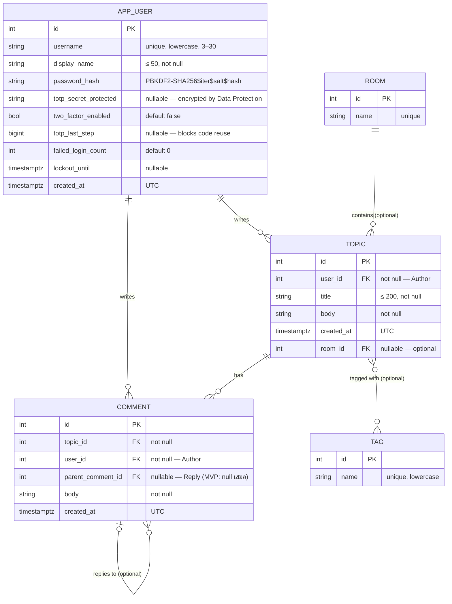

# Webboard — Architecture

เอกสารนี้อธิบายว่าระบบแบ่งเป็นส่วนไหน แต่ละส่วนรับผิดชอบอะไร และข้อมูลไหลผ่านอย่างไร
อ่านคู่กับ [SPECREQUIREMENT.md](SPECREQUIREMENT.md) (ต้องทำอะไร) และ [TECHSTACK.md](TECHSTACK.md) (ใช้อะไรทำ)
เหตุผลที่เลือกโครงสร้างนี้อยู่ใน [ADR-layered-architecture.md](architecture/decisions/ADR-layered-architecture.md)
ดูตัวอย่างการทำงานแบบคลิกได้ที่ [mockups/webboard-layers.html](mockups/webboard-layers.html) — ข้อมูลอยู่ในหน่วยความจำของหน้าเว็บ ไม่ได้ต่อ API หรือฐานข้อมูลจริง

## Contents

1. [ภาพรวม](#1-ภาพรวม)
2. [Layer และหน้าที่](#2-layer-และหน้าที่)
3. [กฎการพึ่งพา (Dependency Rules)](#3-กฎการพึ่งพา-dependency-rules)
4. [โครงสร้าง Repository](#4-โครงสร้าง-repository)
5. [Request Flow](#5-request-flow)
6. [Data Model](#6-data-model)
7. [REST API](#7-rest-api)
8. [Feature Pillars (MVP / Optional)](#8-feature-pillars-mvp--optional)
9. [Authentication (Login + 2FA)](#9-authentication-login--2fa)

---

## 1. ภาพรวม

```
┌─────────────────────────────┐
│  Presentation Layer         │   UI (เลือกเทคโนโลยีได้อิสระ)
└──────────────┬──────────────┘
               │  HTTP + JSON (REST)
┌──────────────▼──────────────┐
│  Domain Layer               │   ASP.NET Core Web API
│  Controllers → Services     │   validation + business rules
└──────────────┬──────────────┘
               │  method call (C#)
┌──────────────▼──────────────┐
│  Data Access Layer          │   Entity Framework Core
│  DbContext / Entities       │   mapping + migrations
└──────────────┬──────────────┘
               │  SQL (Npgsql)
┌──────────────▼──────────────┐
│  Database: PostgreSQL       │
└─────────────────────────────┘
```

## 2. Layer และหน้าที่

| Layer | ทำ | ไม่ทำ |
| --- | --- | --- |
| **Presentation** | แสดงผล, รับ input, เรียก REST API, escape ข้อความก่อนแสดง | ไม่ต่อฐานข้อมูล, ไม่เก็บ business rule ที่ต้องเชื่อถือได้ (validation ฝั่ง UI เป็นแค่ UX) |
| **Domain** (ASP.NET) | กำหนด endpoint, ตรวจ token, ตรวจ input, hash/ตรวจรหัสผ่าน, ตรวจรหัส 2FA, บังคับ business rule (เช่น Reply ต้องอยู่ Topic เดียวกับแม่), แปลง Entity ↔ DTO, คืน HTTP status ที่ถูกต้อง | ไม่เขียน SQL เอง, ไม่ส่ง Entity ของ EF ออกไปเป็น response ตรงๆ, ไม่เชื่อชื่อผู้เขียนที่ส่งมาใน body |
| **Data Access** (EF Core) | `DbContext`, Entity class, การ map ตาราง (Fluent API), Migrations | ไม่มี business rule, ไม่รู้จัก HTTP |
| **Database** | เก็บข้อมูล, บังคับ constraint (FK, NOT NULL, unique) | — |

## 3. กฎการพึ่งพา (Dependency Rules)

ทิศทางเดียวจากบนลงล่าง — layer ล่างไม่รู้จัก layer บน

1. `Presentation → Domain` ผ่าน HTTP เท่านั้น (ไม่ share code)
2. `Webboard.Api` (Domain) อ้างอิง `Webboard.DataAccess` ได้; **ห้ามกลับทาง**
3. Controller เรียก Service; Service เรียก `DbContext` — Controller ไม่แตะ `DbContext` ตรง
4. Response ทุกตัวเป็น DTO (`record`) ไม่ใช่ Entity — กัน navigation property วนลูป และกันข้อมูลที่ไม่ควรออก
5. Constraint สำคัญต้องอยู่ทั้งใน Domain (ตอบ `400` ที่อ่านรู้เรื่อง) และใน Database (กันข้อมูลเสียถ้าโค้ดพลาด)

## 4. โครงสร้าง Repository

> โครงสร้างที่วางแผนไว้ — ปรับเมื่อสร้าง solution จริงและอัปเดตเอกสารนี้ใน PR เดียวกัน

```
Project_SASD/
  Webboard.sln
  src/
    Webboard.Api/            Domain Layer — ASP.NET Core Web API
      Controllers/           AuthController, TopicsController, CommentsController
      Services/              AuthService, TopicService, CommentService (business rules)
      Security/              PasswordHasher (PBKDF2-SHA256), TotpService, TokenService (JWT)
      Dtos/                  request/response records
      Program.cs             DI, routing, authentication, error handling
    Webboard.DataAccess/     Data Access Layer — EF Core
      Entities/              User, Topic, Comment (+ Tag, Room เมื่อทำ optional)
      Configurations/        IEntityTypeConfiguration<T> (Fluent API)
      Migrations/            สร้างด้วย dotnet ef เท่านั้น ห้ามแก้มือ
      WebboardDbContext.cs
    webboard-web/            Presentation Layer — React + Vite + TypeScript (ADR-presentation-technology)
  tests/
    Webboard.Api.Tests/      unit + integration tests ของ Domain Layer
  docs/
```

## 5. Request Flow

ตัวอย่าง: เขียน Comment (FR-COMMENT-001)

1. **Presentation** ส่ง `POST /api/topics/42/comments` header `Authorization: Bearer <access token>` body `{ "body": "..." }`
2. **ASP.NET authentication** ตรวจ token (`[Authorize]`) — ไม่มี / หมดอายุ / เป็น MFA token → `401` ทันที ก่อนดู body (FR-AUTH-007)
3. **Controller** รับ request — model validation (`[Required]`, `[MaxLength]`) ไม่ผ่าน → `400` (FR-TOPIC-004 รูปแบบเดียวกัน)
4. **Service** เช็กว่า Topic 42 มีอยู่ — ไม่มี → `404` (FR-COMMENT-003)
5. **Service** สร้าง `Comment` entity, ตั้ง `UserId` จาก claim `sub` ของ token และ `CreatedAt = DateTime.UtcNow`, เรียก `SaveChangesAsync()`
6. **Data Access** (EF Core) แปลงเป็น `INSERT` ไป PostgreSQL
7. **Controller** แปลง entity เป็น `CommentDto` แล้วตอบ `201 Created` พร้อม header `Location`

## 6. Data Model



- **MVP** ใช้ `APP_USER`, `TOPIC` และ `COMMENT` (ยังไม่มี `room_id`, `TAG`, `ROOM`) — คอลัมน์ `parent_comment_id` สร้างตั้งแต่ migration ของ MVP แต่ API ของ MVP ไม่รับค่านี้ จึงเป็น `null` เสมอ ([spec-webboard-mvp](../task-plans/spec/spec-webboard-mvp.md) D13)
- ตารางผู้ใช้ชื่อ `app_user` เพราะ `user` เป็นคำสงวนของ PostgreSQL; ชื่อผู้เขียนที่แสดงมาจาก join `app_user.display_name`
- **Reply** ไม่ใช่ตารางแยก — คือ `COMMENT` ที่มี `parent_comment_id` (ดู [CONTEXT.md](../CONTEXT.md))
- `TOPIC ↔ TAG` เป็น many-to-many ผ่านตารางเชื่อม `topic_tag` (EF Core สร้างให้อัตโนมัติ)
- ลบ Topic → ลบ Comment ตาม และลบ Comment → ลบ Reply ของมันตาม (`ON DELETE CASCADE` ทั้งคู่) — แม้ MVP จะยังไม่มีการลบ ก็ตั้งไว้ให้ข้อมูลไม่ค้าง

## 7. REST API

Base path: `/api` · รูปแบบ JSON แบบ camelCase · Swagger UI ที่ `/swagger` ตอน dev

คอลัมน์ Token: — = ไม่ต้อง login · **MFA** = MFA token · **Access** = access token

| Method | Path | Token | FR | ผลลัพธ์ |
| --- | --- | --- | --- | --- |
| `POST` | `/api/auth/register` | — | FR-AUTH-001 | `201` ผู้ใช้ใหม่ · `400` · `409` username ซ้ำ |
| `POST` | `/api/auth/login` | — | FR-AUTH-003 | `200` `{ mfaToken, twoFactorSetupRequired }` · `401` · `429` |
| `POST` | `/api/auth/2fa/setup` | MFA | FR-AUTH-004 | `200` `{ sharedKey, otpAuthUri }` · `409` ถ้าตั้งไว้แล้ว |
| `POST` | `/api/auth/2fa/verify` | MFA | FR-AUTH-005 | `200` `{ accessToken, expiresIn, user }` · `401` รหัสผิด · `429` |
| `GET` | `/api/auth/me` | Access | FR-AUTH-008 | `200` ผู้ใช้ปัจจุบัน · `401` |
| `GET` | `/api/topics` | — | FR-TOPIC-002 | `200` รายการ Topic (ใหม่ → เก่า) |
| `POST` | `/api/topics` | Access | FR-TOPIC-001 | `201` Topic ที่สร้าง · `400` ถ้า input ผิด · `401` |
| `GET` | `/api/topics/{id}` | — | FR-TOPIC-003 | `200` Topic + Comments · `404` |
| `POST` | `/api/topics/{id}/comments` | Access | FR-COMMENT-001 | `201` Comment · `400` · `401` · `404` |
| `POST` | `/api/topics/{id}/comments` + `parentCommentId` | Access | FR-REPLY-001 | *(optional)* `201` · `400` ถ้าแม่อยู่คนละ Topic |
| `GET` | `/api/topics?tag={name}` | — | FR-TAG-002 | *(optional)* |
| `GET` | `/api/rooms` | — | FR-ROOM-001 | *(optional)* |
| `GET` | `/api/rooms/{id}/topics` | — | FR-ROOM-003 | *(optional)* |

**Error contract:** ทุก error ตอบเป็น [RFC 9457 Problem Details](https://www.rfc-editor.org/rfc/rfc9457) (`application/problem+json`) ซึ่ง ASP.NET Core สร้างให้ผ่าน `AddProblemDetails()` — validation error มี `errors` แยกตาม field

## 8. Feature Pillars (MVP / Optional)

แต่ละ pillar แบ่ง 2 ระดับ:
- **MVP** — ต้องมีจึงจะผ่าน requirement ขั้นต่ำ
- **Optional** — ทำเพิ่มเมื่อ MVP เสร็จและผ่านการทดสอบแล้ว

### 8.1 Topic
- **MVP** — สร้าง, ดูรายการ, ดูรายละเอียด
- **Optional** — แบ่งหน้า (pagination), ค้นหาด้วยคำใน Title, กรองตาม Tag/Room

### 8.2 Comment
- **MVP** — เขียน Comment ใน Topic, แสดงเรียงตามเวลา
- **Optional** — Reply ซ้อนกัน (แนะนำจำกัดความลึกที่ UI เช่น 3 ชั้น เพื่ออ่านง่าย)

### 8.3 Organization (Tag / Room)
- **Optional** — Tag หลายอันต่อ Topic, Room หนึ่งอันต่อ Topic

### 8.4 Authentication
- **MVP** — สมัคร, login ด้วยรหัสผ่าน + 2FA (TOTP) บังคับทุกคน, ล็อกเมื่อผิดซ้ำ (ดู §9)
- **Optional** — recovery code, เปลี่ยน/ลืมรหัสผ่าน, refresh token

### 8.5 อื่นๆ (ยังไม่อยู่ในขอบเขต — ดู SPECREQUIREMENT §2.3)
- แก้ไข-ลบโพสต์, โหวต/like, real-time update

## 9. Authentication (Login + 2FA)

เหตุผลของแต่ละข้ออยู่ใน [ADR-auth-password-2fa.md](architecture/decisions/ADR-auth-password-2fa.md)

```
 สมัคร   POST /auth/register ─────────────► app_user (password_hash = PBKDF2-SHA256, 2FA ยังไม่เปิด)

 ขั้น 1   POST /auth/login {username, password}
            │ PBKDF2 ตรง?  ── ไม่ ──► 401 (failed_login_count++ ; ครบ 5 → ล็อก 15 นาที → 429)
            ▼ ใช่
          200 { mfaToken (5 นาที), twoFactorSetupRequired }
            │
            ├─ ยังไม่ตั้ง 2FA ─► POST /auth/2fa/setup (MFA) ─► { sharedKey, otpAuthUri } ─► UI แสดง QR ─► ผู้ใช้สแกน
            ▼
 ขั้น 2   POST /auth/2fa/verify (MFA) {code}
            │ TOTP ตรง (±30 วินาที, ไม่ซ้ำรหัสเดิม)?  ── ไม่ ──► 401 (นับรวมกับ failed_login_count)
            ▼ ใช่ (ถ้าเพิ่งตั้ง → two_factor_enabled = true)
          200 { accessToken (60 นาที) } ─► UI เก็บ token ไว้ในหน่วยความจำ แล้วส่งเป็น Authorization: Bearer
```

### 9.1 แต่ละ layer ทำอะไร

| Layer | หน้าที่ด้าน auth |
| --- | --- |
| Presentation | ฟอร์มสมัคร/login/2FA, แสดง QR จาก `otpAuthUri`, เก็บ access token ในหน่วยความจำ (ไม่ใส่ใน URL), ลบ token เมื่อ logout หรือได้ `401` |
| Domain | `PasswordHasher` (PBKDF2-HMAC-SHA256 600,000 รอบ), `TotpService` (RFC 6238), `TokenService` (ออก/ตรวจ JWT, claim `purpose`), นับครั้งที่ผิดและล็อก, `[Authorize]` บน endpoint ที่ต้อง login |
| Data Access | Entity `User` → ตาราง `app_user`, unique index บน `username` |
| Database | เก็บ hash และ shared key ที่เข้ารหัสแล้วเท่านั้น — ไม่มีรหัสผ่านหรือ shared key แบบอ่านได้ |

### 9.2 รูปแบบที่เก็บ

| ค่า | เก็บเป็น | ตัวอย่าง |
| --- | --- | --- |
| รหัสผ่าน | `PBKDF2-SHA256$<iterations>$<salt base64>$<hash base64>` | `PBKDF2-SHA256$600000$j+w8Vamb…$1Nqui…` |
| Shared key ของ 2FA | ผลของ `IDataProtector.Protect()` (ถอดได้เฉพาะเครื่องที่มี key ring) | `CfDJ8N3x…` |
| Access / MFA token | ไม่เก็บใน DB (stateless JWT) — ตรวจด้วย signing key จาก user-secrets | — |
